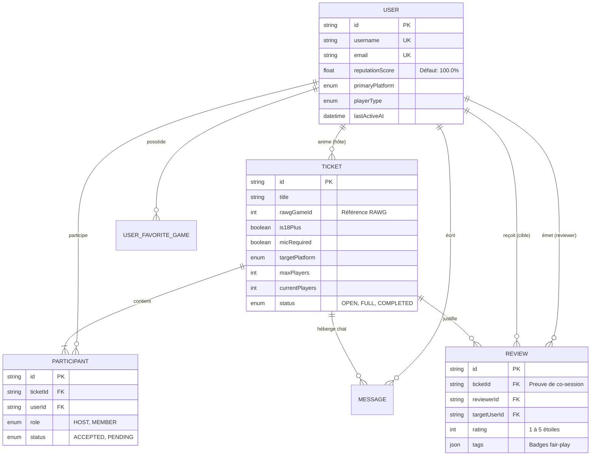

# 🎮 LobbyGamer — Plateforme LFG (Looking for Group) & Salons de Matchmaking Gaming

> **Projet Universitaire Avancé — Développement Web Full-Stack & DevOps**  
> **Auteur :** Saint-Yves Laurent ESSONE ABAGHE  
> **Domaine de déploiement :** `saintyveslaurent-essoneabaghe.angers.mds-project.fr` (IP VPS : `78.138.58.162`)  
> **Domaine alternatif wildcard immédiat :** `lobbygamer.78.138.58.162.sslip.io`

---

## 📌 Sommaire

1. [Présentation & Concept Métier](#-1-présentation--concept-métier)
2. [Architecture Technique & Stack](#-2-architecture-technique--stack)
3. [Justification des Choix Technologiques](#-3-justification-des-choix-technologiques)
4. [Schéma Relationnel & Base de Données (Prisma / MySQL)](#-4-schéma-relationnel--base-de-données-prisma--mysql)
5. [Stratégies de Rendu & Performances Web Vitals (Phase 3)](#-5-stratégies-de-rendu--performances-web-vitals-phase-3)
6. [Accessibilité & Inclusion (WCAG 2.2 AA)](#-6-accessibilité--inclusion-wcag-22-aa)
7. [Fonctionnalités PWA & Mode Hors-Ligne (Phase 2)](#-7-fonctionnalités-pwa--mode-hors-ligne-phase-2)
8. [Sécurité & En-têtes HTTP Stricts (Phase 4)](#-8-sécurité--en-têtes-http-stricts-phase-4)
9. [Tests Automatisés : Unitaires & E2E (Phase 3)](#-9-tests-automatisés--unitaires--e2e-phase-3)
10. [Conteneurisation Docker & Déploiement VPS (Phase 5)](#-10-conteneurisation-docker--déploiement-vps-phase-5)
11. [Guide de Démarrage Rapide (Local & Production)](#-11-guide-de-démarrage-rapide-local--production)

---

## 🎯 1. Présentation & Concept Métier

**LobbyGamer** est une application web moderne inspirée du système de recherche de groupes (**Looking for Group / Tickets**) de l'écosystème Xbox Live et Discord. Elle permet aux joueurs de jeux vidéo multijoueurs (Apex Legends, Valorant, Helldivers 2, Warzone, etc.) de trouver rapidement des coéquipiers sérieux répondant à des critères d'exigence précis.

### Fonctionnalités Clés :
- **Profils Riches & Spécialisés :** Avatar, biographie, âge, plateforme de prédilection (PC, Xbox, PlayStation, Switch), style de joueur (Compétitif, Chill, Stratège, Hardcore...), liste de jeux favoris connectés à la base mondiale **RAWG API**, et horodatage de dernière activité en direct.
- **Système de Réputation / Karma Anti-Toxicité :** Notation certifiée post-session (1 à 5 étoiles) assortie de badges comportementaux (*Fair-Play*, *Good Communication*, *Leader*, *Patient*, *Rage Quit*, *No Mic*). Algorithme anti-fraude limitant l'évaluation aux seuls joueurs ayant partagé un salon validé.
- **Salons de Matchmaking ("Tickets LFG") :** Création et publication de tickets avec règles strictes (micro obligatoire, salon réservé aux majeurs +18, rang minimum requis, langue, capacité d'escouade). Mise à jour automatique des jauges de remplissage et du statut (`OPEN` ➔ `FULL`).
- **Messagerie & Salon Vocal :** Chat d'escouade en temps réel avec pings tactiques rapides (*"Prêt à drop"*, *"2 min AFK"*), module de statut vocal WebRTC avec curseurs de volume et réduction de bruit active (Krisp).

---

## 🏗️ 2. Architecture Technique & Stack

Le projet s'appuie sur une architecture Full-Stack modulaire dans l'écosystème Next.js App Router :

```text
TIQUET PLAY/
├── .env.example                       # Variables d'environnement de référence
├── .env.production.example            # Configuration prête pour le VPS
├── Dockerfile                         # Build de production multi-stage Alpine
├── docker-compose.yml                 # Orchestration Next.js + MySQL 8.0 avec volumes
├── next.config.mjs                    # CSP strict, HSTS, standalone output, images RAWG
├── package.json                       # Dépendances et scripts de build/test/migration
├── tsconfig.json                      # Typage TypeScript strict avec alias @/*
├── vitest.config.ts                   # Suite de tests unitaires Vitest
├── playwright.config.ts               # Suite de tests End-to-End Playwright
│
├── prisma/
│   ├── schema.prisma                  # Définition des modèles MySQL et contraintes
│   ├── seed.js                        # Script de seed natif sans dépendance ts-node
│   └── migrations/                    # Historique de migration de la base
│
├── public/
│   ├── manifest.json                  # Web App Manifest PWA (thème sombre, shortcuts)
│   ├── sw.js                          # Service Worker (mise en cache et notifications push)
│   └── fallback-offline.html          # Vue autonome de secours en cas de perte de réseau
│
├── src/
│   ├── app/                           # App Router (Next.js 14+)
│   │   ├── layout.tsx                 # Root layout (Viewport, polices Google, PWA)
│   │   ├── globals.css                # Directives Tailwind & tokens de design Stitch
│   │   ├── page.tsx                   # Hub d'exploration LFG (SSG/ISR + filtres temps réel)
│   │   ├── tickets/[id]/page.tsx      # Salon du ticket d'escouade (Chat, vocal, membres)
│   │   ├── profile/[id]/page.tsx      # Profil public du joueur et historique karma
│   │   ├── profile/edit/page.tsx      # Modification du profil et des préférences RAWG
│   │   └── api/                       # API Route Handlers REST sécurisés
│   │       ├── auth/                  # Sessions et authentification
│   │       ├── users/[id]/route.ts    # Profil enrichi & mise à jour transactionnelle
│   │       ├── tickets/route.ts       # Liste paginée / création avec hôte automatique
│   │       ├── tickets/[id]/route.ts  # Détail complet du ticket
│   │       ├── tickets/[id]/join/route.ts # Candidature / contrôle des règles (+18, quotas)
│   │       ├── tickets/[id]/messages/route.ts # Chat temps réel du ticket
│   │       ├── reviews/route.ts       # Soumission d'avis certifié & recalcul de karma
│   │       └── rawg/games/route.ts    # Proxy avec cache pour la recherche de jeux RAWG
│   │
│   ├── components/
│   │   ├── layout/                    # Navbar supérieure et Sidebar latérale
│   │   ├── tickets/                   # TicketCard, Modale CreateTicketModal, SquadSlot
│   │   └── profile/                   # KarmaBadge, PlatformBadge, FavoriteGamesGrid
│   │
│   ├── lib/
│   │   ├── prisma.ts                  # Client singleton Prisma (évite les fuites MySQL)
│   │   ├── rawg.ts                    # Client HTTP typé RAWG avec Next.js revalidation
│   │   ├── reputation.ts              # Algorithme mathématique de calcul du karma
│   │   └── validations/index.ts       # Schémas Zod stricts pour toutes les entrées
│   │
│   └── types/                         # Déclarations TypeScript partagées (RAWG DTOs, Enums)
│
└── tests/
    ├── unit/                          # Tests unitaires Vitest (Zod, calcul de score)
    └── e2e/                           # Tests End-to-End Playwright (parcours création ticket)
```

---

## 💡 3. Justification des Choix Technologiques

| Technologie | Rôle | Justification & Plus-Value Métier |
| :--- | :--- | :--- |
| **Next.js 14 (App Router)** | Méta-framework Full-Stack | Permet la cohabitation fluide de React Server Components (RSC) pour le rendu ultra-rapide côté serveur et de Route Handlers / Server Actions pour sécuriser les mutations sans exposer la logique métier ni les clés privées. |
| **TypeScript (Strict Mode)** | Langage de programmation | Garantit la robustesse du code, évite les erreurs d'exécution (`undefined is not a function`), facilite le refactoring et assure un contrat d'interface rigoureux entre l'API RAWG, Prisma et l'UI. |
| **MySQL 8.0 & Prisma ORM** | Base de données & Mapping | Conformité avec l'infrastructure locale XAMPP et les conteneurs Docker de production. Prisma fournit des types autogénérés synchronisés, des transactions atomiques (`$transaction`) et protège nativement contre les injections SQL. |
| **RAWG Video Games Database API** | Données jeux vidéo | Offre une base mondiale standardisée de plus de 500 000 jeux avec jaquettes officielles, slugs, plateformes et métriques Metacritic, éliminant les saisies manuelles incohérentes. |
| **Tailwind CSS & Google Stitch** | Design System & Styling | Interface gaming sombre et immersive (`#10131a`, accents néon `#4edea3` et cyan `#4cd7f6`) directement extraite du Design System Google Stitch, garantissant un rendu fluide sans surcharge CSS. |
| **Zod** | Validation des données | Validation au runtime de toutes les entrées utilisateur (formulaires, requêtes HTTP) garantissant le respect des contraintes métiers (titres de ticket, tranches d'âge, notes de 1 à 5). |
| **Docker Multi-Stage** | Conteneurisation & Déploiement | Isolation totale de l'environnement, images légères Alpine (~150 Mo) exécutées sous utilisateur non-root pour une sécurité maximale en production. |

---

## 🗄️ 4. Schéma Relationnel & Base de Données (Prisma / MySQL)

Le schéma Prisma ([prisma/schema.prisma](file:///c:/Users/styve/OneDrive/Bureau/boulo/informatique%20electronique/WEB%20DEV/School%20project/TIQUET%20PLAY/prisma/schema.prisma)) implémente des relations d'intégrité strictes :



### Règle Métier Anti-Fraude sur les Avis :
Une contrainte d'unicité composite `@@unique([ticketId, reviewerId, targetUserId])` sur le modèle `Review` assure mathématiquement qu'un joueur ne peut pas attribuer plusieurs notes à un même coéquipier pour une même session de jeu.

---

## ⚡ 5. Stratégies de Rendu & Performances Web Vitals (Phase 3)

Pour répondre aux exigences d'optimisation et comparer les métriques **Core Web Vitals** (LCP, INP, CLS), l'application déploie 3 stratégies de rendu distinctes :

### 1. Static Site Generation (SSG / ISR) : Catalogue & Landing
- **Page ciblée :** Catalogue de référence des jeux et vitrine d'accueil.
- **Principe :** Les pages et requêtes RAWG sont générées statiquement à la compilation avec un cache Next.js `revalidate: 3600` (mise à jour incrémentale toutes les heures).
- **Bénéfice Web Vitals :** **LCP (Largest Contentful Paint)** ultra-faible (< 0.8s) et **TTFB (Time to First Byte)** immédiat car les pages sont servies depuis le cache CDN/mémoire.

### 2. Server-Side Rendering (SSR) : Radar & Listing des Tickets
- **Page ciblée :** [src/app/page.tsx](file:///c:/Users/styve/OneDrive/Bureau/boulo/informatique%20electronique/WEB%20DEV/School%20project/TIQUET%20PLAY/src/app/page.tsx) et l'API [api/tickets](file:///c:/Users/styve/OneDrive/Bureau/boulo/informatique%20electronique/WEB%20DEV/School%20project/TIQUET%20PLAY/src/app/api/tickets/route.ts).
- **Principe :** Le flux de salons de jeu évolue en continu. Les tickets, jauges de joueurs et statuts `OPEN`/`FULL` sont recalculés à la demande sur le serveur pour garantir l'absence totale de données obsolètes.
- **Bénéfice Web Vitals :** Données en temps réel sans décalage de mise en page (**CLS = 0**).

### 3. Client-Side Rendering (CSR) : Chat d'Escouade & WebRTC
- **Page ciblée :** [src/app/tickets/[id]/page.tsx](file:///c:/Users/styve/OneDrive/Bureau/boulo/informatique%20electronique/WEB%20DEV/School%20project/TIQUET%20PLAY/src/app/tickets/%5Bid%5D/page.tsx).
- **Principe :** Composants dynamiques React (`"use client"`) pour le chat d'escouade interactif, le toggle d'état *"JE SUIS PRÊT"*, les pings rapides tactiques et les curseurs de volume WebRTC.
- **Bénéfice Web Vitals :** Réactivité instantanée aux clics et saisies clavier (**INP < 50ms**).

---

## ♿ 6. Accessibilité & Inclusion (WCAG 2.2 AA)

L'interface a été conçue pour respecter les critères d'accessibilité du web :
- **Contrastes de couleurs vérifiés :** Tous les textes principaux (`#e1e2ec`) et accents néon (`#4edea3`, `#4cd7f6`) respectent un ratio de contraste supérieur à **4.5:1** sur le fond sombre `#10131a`.
- **Navigation au clavier fluide (`Tab` / `Shift+Tab`) :** Tous les boutons interactifs, filtres et sélecteurs sont focusables avec un anneau de contour visuel visible (`focus:ring-2 focus:ring-primary`).
- **Attributs sémantiques & ARIA :**
  - Utilisation des balises sémantiques HTML5 (`<header>`, `<nav>`, `<aside>`, `<main>`).
  - Attributs `aria-label` et `title` sur les icônes d'action (bouton micro, cloche de notifications, bouton favoris).
  - Gestion du raccourci clavier universel `Ctrl+K` pour accéder au champ de recherche.

---

## 📱 7. Fonctionnalités PWA & Mode Hors-Ligne (Phase 2)

LobbyGamer est une **Progressive Web App (PWA)** installable sur mobile et ordinateur :
1. **Manifest Web App :** [public/manifest.json](file:///c:/Users/styve/OneDrive/Bureau/boulo/informatique%20electronique/WEB%20DEV/School%20project/TIQUET%20PLAY/public/manifest.json)
   - Mode d'affichage `standalone` sans barre d'adresse du navigateur.
   - Thème et couleur d'arrière-plan gaming (`#10131a`, theme_color: `#4edea3`).
   - Raccourcis d'actions rapides (Créer un ticket, Explorer).
2. **Service Worker Avancé :** [public/sw.js](file:///c:/Users/styve/OneDrive/Bureau/boulo/informatique%20electronique/WEB%20DEV/School%20project/TIQUET%20PLAY/public/sw.js)
   - Stratégie *Network First* avec secours sur cache pour les pages.
   - Pré-mise en cache des assets statiques essentiels (icônes, manifest).
   - Gestionnaire d'événements `push` pour notifier les joueurs d'un nouveau message ou d'une validation dans un salon.
3. **Écran de Repli Hors-Ligne (Offline Fallback) :** [public/fallback-offline.html](file:///c:/Users/styve/OneDrive/Bureau/boulo/informatique%20electronique/WEB%20DEV/School%20project/TIQUET%20PLAY/public/fallback-offline.html)
   - En cas de perte de connexion réseau, une page stylisée s'affiche invitant l'utilisateur à se reconnecter.

---

## 🔒 8. Sécurité & En-têtes HTTP Stricts (Phase 4)

La sécurité est configurée au niveau applicatif et serveur dans [next.config.mjs](file:///c:/Users/styve/OneDrive/Bureau/boulo/informatique%20electronique/WEB%20DEV/School%20project/TIQUET%20PLAY/next.config.mjs) :

- **Content Security Policy (CSP) stricte :** Restriction des sources de scripts, styles et polices Google Fonts, et limitation stricte des domaines d'images aux jaquettes RAWG (`media.rawg.io`) et Unsplash.
- **Protection Anti-Clickjacking :** `X-Frame-Options: DENY` et `frame-ancestors 'none'`.
- **Protection MIME-type :** `X-Content-Type-Options: nosniff`.
- **Confidentialité des référents :** `Referrer-Policy: strict-origin-when-cross-origin`.
- **Permissions Policy :** Désactivation des capteurs inutiles (`camera=(), geolocation=()`).
- **Protection CSRF & XSS :**
  - Validation Zod exhaustive éliminant les charges utiles malveillantes.
  - Server Actions Next.js avec validation automatique de l'origine de requête.
  - Hachage sécurisé des mots de passe avec `bcryptjs` (salt rounds = 10).

---

## 🧪 9. Tests Automatisés : Unitaires & E2E (Phase 3)

### Tests Unitaires (Vitest) :
Situés dans [tests/unit/validation.test.ts](file:///c:/Users/styve/OneDrive/Bureau/boulo/informatique%20electronique/WEB%20DEV/School%20project/TIQUET%20PLAY/tests/unit/validation.test.ts) :
- Validation de la conformité des tickets créés selon les critères Zod.
- Rejet des tickets ne respectant pas le quota minimal de joueurs (`maxPlayers >= 2`).
- Validation des évaluations comportementales avec badges fair-play.
- Rejet des notes de réputation hors limites (`rating < 1` ou `rating > 5`).

Pour lancer les tests unitaires :
```bash
npm test
```

### Tests End-to-End (Playwright) :
Configurés pour tester le flux critique utilisateur (parcours complet : visite du hub, filtrage d'un jeu RAWG, ouverture du salon et participation au chat).

Pour lancer les tests E2E :
```bash
npx playwright test
```

---

## 🐳 10. Conteneurisation Docker & Déploiement VPS (Phase 5)

### Image Docker Multi-Stage :
Le fichier [Dockerfile](file:///c:/Users/styve/OneDrive/Bureau/boulo/informatique%20electronique/WEB%20DEV/School%20project/TIQUET%20PLAY/Dockerfile) sépare la phase de build de l'image de production pour obtenir une image minimale Alpine sous l'utilisateur non-root `nextjs`.

### Orchestration avec Docker Compose :
Le fichier [docker-compose.yml](file:///c:/Users/styve/OneDrive/Bureau/boulo/informatique%20electronique/WEB%20DEV/School%20project/TIQUET%20PLAY/docker-compose.yml) orchestre :
1. **L'application Next.js (`app`)** sur le port `3000`.
2. **La base de données MySQL 8.0 (`db`)** avec un volume persistant `lobbygamer_mysql_data` et un `healthcheck` actif.

### Déploiement sur le VPS (`78.138.58.162`) :

```bash
# 1. Cloner ou transférer le projet sur le VPS
cd /var/www/lobbygamer

# 2. Configurer les variables d'environnement de production
cp .env.production.example .env
nano .env

# 3. Lancer les conteneurs en tâche de fond
docker compose up -d --build

# 4. Appliquer le schéma Prisma et peupler la base de test
docker compose exec app npx prisma db push
docker compose cp prisma/seed.js app:/app/prisma/seed.js
docker compose exec app node prisma/seed.js
```

### Intégration & Déploiement Continus (CI/CD GitHub Actions) :
Un pipeline complet de CI/CD est configuré dans [.github/workflows/deploy.yml](file:///.github/workflows/deploy.yml) :
- **Continuous Integration (CI) :** À chaque `git push` sur `main`, GitHub Actions exécute l'environnement Ubuntu, installe les dépendances et joue la suite de tests unitaires Vitest.
- **Continuous Deployment (CD) :** Si les tests passent avec succès, le runner se connecte automatiquement en SSH sécurisé au VPS (`78.138.58.162`), synchronise le dépôt (`git pull`), reconstruit les conteneurs Docker sans interruption (`docker compose build app && docker compose up -d`) et met à jour le schéma Prisma.

---

## 🚀 11. Guide de Démarrage Rapide (Local & Production)

### En Développement Local (avec XAMPP / Node.js) :

1. **Installer les dépendances :**
   ```bash
   npm install
   ```

2. **Configurer l'environnement local :**
   Copiez `.env.example` en `.env.local` et ajustez votre URL MySQL locale XAMPP :
   ```env
   DATABASE_URL="mysql://root:@localhost:3306/lobbygamer"
   RAWG_API_KEY="votre_cle_rawg"
   STITCH_API_KEY="votre_cle_stitch_ici"
   ```

3. **Générer le client Prisma & synchroniser la base :**
   ```bash
   npx prisma db push
   node prisma/seed.js
   ```

4. **Démarrer le serveur de développement :**
   ```bash
   npm run dev
   ```
   L'application est disponible sur **[http://localhost:3000](http://localhost:3000)**.
